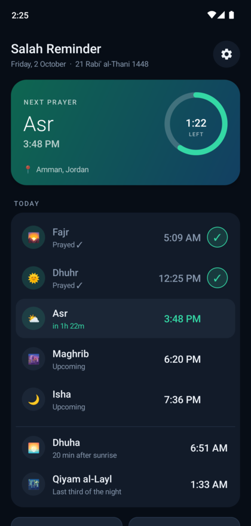
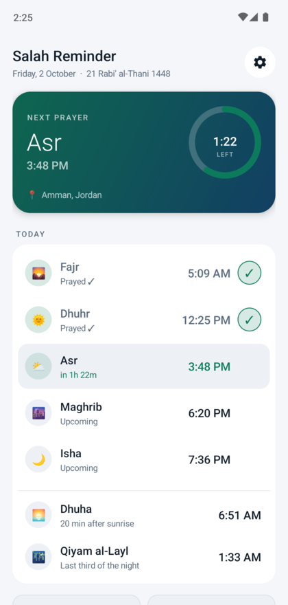
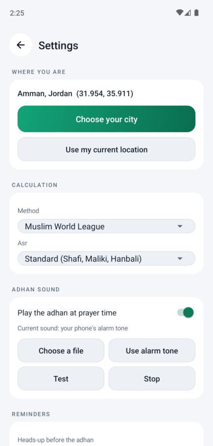
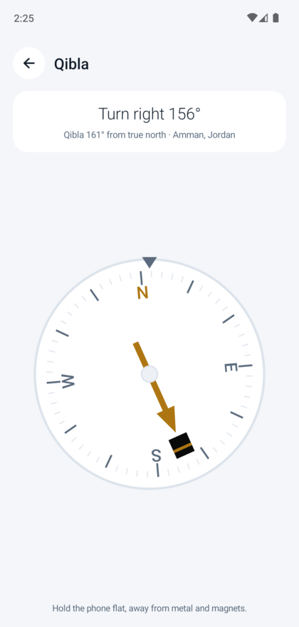
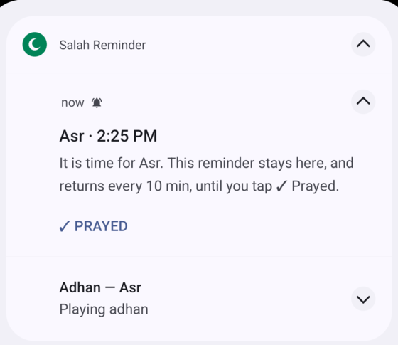

#  Salah Reminder

An offline Android app for the five daily prayers: it works out the times where you are,
plays your own adhan, and keeps a reminder pinned in the notification panel until you
confirm you've prayed.

About 3 MB, Android 8.0 or newer, and it updates itself from then on.
No account, no ads, no internet needed, nothing running in the background.

## 📸 What it looks like

| Home (dark) | Home (light) | Settings | Qibla |
| :---: | :---: | :---: | :---: |
|  |  |  |  |

And the reminder that stays in the notification panel until you confirm:

## ✨ What it does

- 🕌 **Prayer times computed on the phone** — from the sun's position, no internet once your
  location is set. The method follows the country you're in from the first launch; seventeen
  methods, Hanafi Asr and your own Fajr and Isha angles are there if your mosque differs.
- 📏 **Times that match your mosque** — nudge any prayer a minute at a time until the app
  agrees with the timetable on the wall.
- 🌍 **34,000 cities, offline** — tap your country, tap your city, done. GPS and raw
  coordinates work too, and each city keeps its own time zone, so Makkah's times stay
  Makkah's wherever your phone is.
- 🔊 **An adhan in the box** — a full adhan ships with the app and plays at the phone's
  *alarm* volume. Prefer another? Point it at any audio file.
- 🔔 **Heads-up before the adhan** — "Asr in 10 min", with the minutes you choose, or off.
- 📌 **A reminder you can't swipe away** — the card stays until you tap **✓ Prayed**, comes
  straight back if your phone dismisses it, and nags every few minutes until you confirm.
- ✅ **Confirm in the app too** — tap the **✓** beside any prayer that has passed, even if you
  never saw the notification; tap again to undo. *Taqabbal Allahu minna wa minkum.*
- 🧭 **Qibla compass** — "turn left / turn right", going green and buzzing when you face Makkah.
- ❄️ **Sane times at any latitude** — where the sun doesn't rise or set, it borrows the nearest
  normal day (*aqrab al-ayyam*); for short summer nights, pick the angle, middle-of-the-night
  or one-seventh rule.
- 🌙 **Qiyam and Dhuha** — optional reminders for the last third of the night and a set time
  after sunrise.
- 🔄 **Updates itself** — a quiet notification when a new version appears, a background
  download, then straight to Android's installer. No store, no sideloading dance.
- 🎨 **Light, dark or system theme** — and it survives reboots, app updates and time-zone changes.
- 📱 **Fits any screen** — phones, landscape, folded and unfolded foldables, and tablets.

🖥 <b>The screens, in detail</b>

**Home** — the next prayer with a live countdown ring, today's five times with their state
(upcoming, waiting for you, passed, prayed), the Gregorian and Hijri date, and a warning banner
if anything on your phone could delay the adhan. Each passed prayer carries a **✓** you can tap
to confirm you prayed it, and tap again to undo.

**Choose your city** — a country list, then the cities in it, biggest first. A filter box is
there if you would rather type.

**Settings** — location, calculation method, Asr school, the short-night rule, per-prayer
fine-tuning, adhan sound, reminder timings, the optional Dhuha and Qiyam reminders, the theme,
and the reliability switches. Everything saves the moment you change it; there is no Save
button.

**Qibla** — a compass dial with a gold needle pointing at the Kaaba.

## 🎯 How accurate is it?

Checked against an independent implementation in twelve cities on six continents: Fajr, Dhuhr,
Maghrib and Isha land on the reference minute, and Asr can be a minute or two out at high
latitudes. Times are shown to the nearest minute; the alarm fires on the exact instant.

## ⬇️ Install

1. On the phone, open
   **[SalahReminder.apk](../../releases/latest/download/SalahReminder.apk)** — the newest
   build, straight from the [releases page](../../releases/latest) — and tap it.
2. Allow "Install unknown apps" for your browser when Android asks.

After that first install, the app updates itself: it checks for new releases, shows
**"Version x.y.z is available"** on the home screen, and tapping it downloads and installs.
There is also **Settings → App → Check for updates now**.

Every push to `main` builds a signed APK and publishes it as a release, so the download link
always gives the newest version.

## 🔧 First-time setup

1. Open the app and allow notifications.
2. Tap **⚙ Settings → Search** your city (or **Use my current location**).
3. The **method** already follows your country — change it, or your **Asr** school, only if
   your mosque follows a different authority.
4. **Adhan sound → Choose a file** → pick your adhan, then **▶ Test** to hear it.
5. Pick the **heads-up** and **repeat** minutes.
6. Tap **Allow background running** — this matters on Samsung, Xiaomi, Oppo and Huawei,
   which otherwise stop the reminders.
7. **Test a full reminder now** to see the whole flow once.

You don't need to leave the app running. Android wakes it at each prayer time; between
times it does nothing and uses no battery.

## 🤝 Contributing

Pull requests, bug reports and feedback are welcome.
[CONTRIBUTING.md](CONTRIBUTING.md) has the build (`./scripts/dev.sh install` fetches its own
JDK and SDK), the Play flavour, release signing, a file-by-file tour and the three rules the
app is built around: no third-party libraries, nothing in the background, works offline.

The most useful report is a timetable that disagrees with the app: your city, the method, and
both sets of times.

Want a feature? **[Open an issue](../../issues/new)** and say so — if it fits the app, I'll
add it.

If the app is useful to you, **[give it a ⭐](../../stargazers)** — it is how other people
find it.

---

And please, don't forget to pray for me. 🤲

*Taqabbal Allahu minna wa minkum.*
